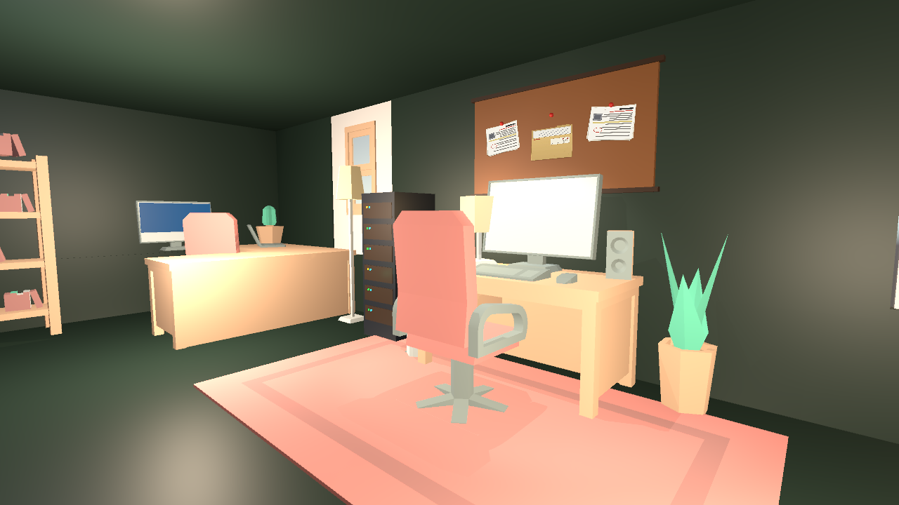
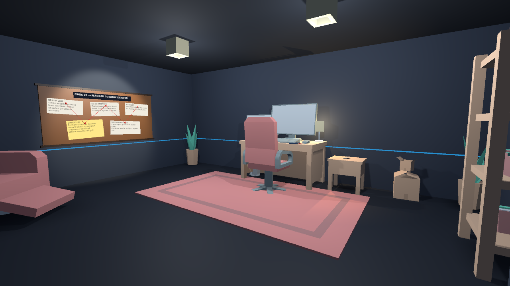
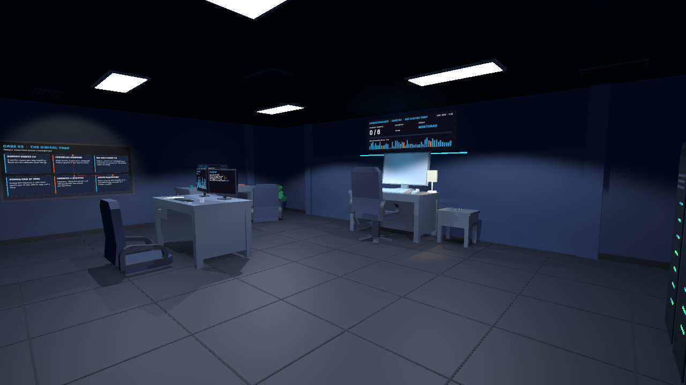
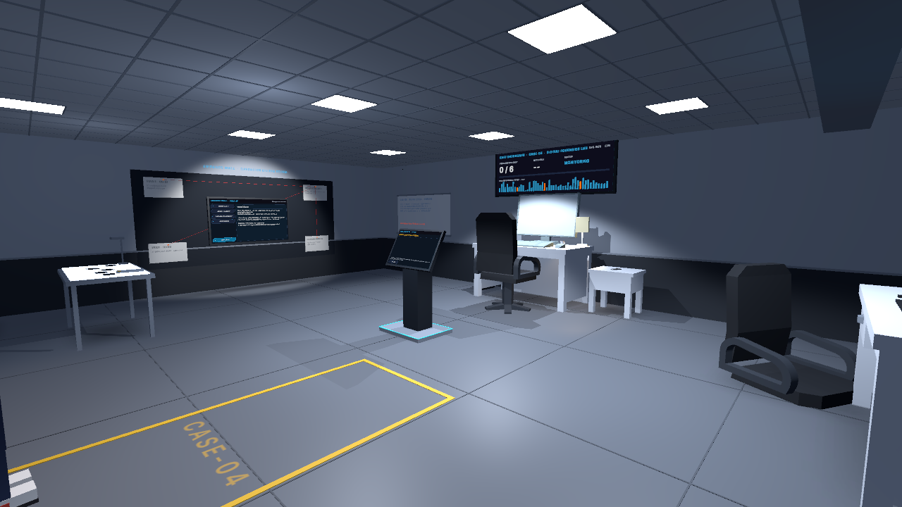
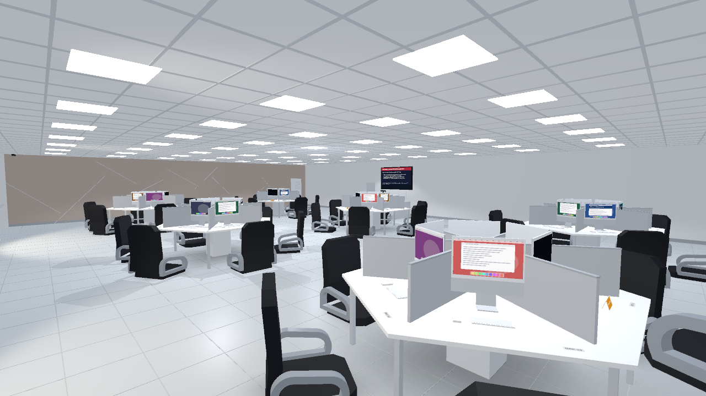

# Scam Sense: Think Before You Click

> A first-person 3D investigation game, made in Unity, that teaches players to spot scam messages before they click. *(BSIT Capstone Project)*


-lightgrey)
[-blue)](https://github.com/c23-2310-967-ops/Scam-Sense/releases/tag/v0.1.1)



You are a cybercrime investigator. Texts, emails, chats, calls and web pages arrive while you explore five 3D rooms, from a family home to a university computer lab. Investigate each one, find the warning signs, and decide: **SCAM** or **LEGITIMATE**, or pick the safest answer to a case question. Every answer explains *why*, so players learn the habits that keep them safe online.

Teachers can run it with a class: students join with a class code, teachers follow their results, and the questions themselves are managed online by an admin, without changing the game's code.

**▶ Download:** [Scam Sense v0.1.1 for Windows](https://github.com/c23-2310-967-ops/Scam-Sense/releases/tag/v0.1.1) (development pre-release). Version **0.2.0** is being prepared (see [Releases and Versioning](#releases-and-versioning)). See [Download and Play](#download-and-play).

## Table of Contents
1. [About the Game](#about-the-game)
2. [Game Features](#game-features)
3. [Gameplay Overview](#gameplay-overview)
4. [Story and Scenarios](#story-and-scenarios)
5. [Screenshots](#screenshots)
6. [Technologies Used](#technologies-used)
7. [System Requirements](#system-requirements)
8. [Download and Play](#download-and-play)
9. [Installation and Setup](#installation-and-setup) (for developers)
10. [Project Structure](#project-structure)
11. [Database and Data Management](#database-and-data-management)
12. [Testing](#testing)
13. [Releases and Versioning](#releases-and-versioning)
14. [Development Status](#development-status)
15. [Future Improvements](#future-improvements)
16. [Troubleshooting](#troubleshooting)
17. [Documentation](#documentation)
18. [Contributing](#contributing)
19. [Team](#team)
20. [License and Credits](#license-and-credits)

---

## About the Game

**Scam Sense** is an educational cybersecurity-awareness game built with **Unity 6** and **C#**.

**The problem.** Phishing texts, fake prize emails, look-alike login pages and "urgent" requests from a fake boss are now part of everyday life. Many people, especially younger users who are new to email, online shopping and school accounts, can't yet tell a scam from a real message, and one wrong click can cost a password, money or personal data.

**How the game teaches.** Instead of reading a list of rules, players *practise* in a safe, simulated world:
- Messages look and behave like the real thing: a phone in your pocket, a mail app on a computer, a captured web page. Every person, link and domain is fictional (`.example` domains), and no real link is ever opened.
- Players inspect the details that matter: the sender and their address, what the message asks for, where a link would really go, and whether it matches something they actually did.
- Every answer is followed by feedback: the correct verdict, an explanation, the clues they found or missed and, after a mistake, what that click would have led to.
- The rooms get harder: Room 1 has no time pressure and obvious signs; Room 5 mixes careful look-alikes with genuine notices that must be checked against official records.

**Educational value.** Players finish able to:
- **Spot common warning signs:** unknown or look-alike senders and domains, urgency and threats, requests for passwords, verification codes, payment or gift cards, and offers that are too good to be true.
- **Recognize legitimate messages:** ones that match something the player really did, ask for nothing sensitive, and point to the official app or site.
- **Check before acting:** inspect first, never click first.
- **Learn from mistakes** in a place where mistakes cost nothing.

**Audience:** students and general users, including younger players, who want to build basic cybersecurity awareness.

## Game Features

Only features that are implemented in the current project are listed.

### Investigation and learning
| Feature | What it does |
|---|---|
| **Five playable rooms** | Each room has its own case briefing, questions, environment and difficulty (see [Story and Scenarios](#story-and-scenarios)). |
| **Validated curriculum questions** | 28 questions in the rooms (plus 4 in reserve), based on the BSIT courses and reviewed by experts. Questions and answer choices are shuffled on every attempt. |
| **Interactive investigations** | Most questions are played inside a simulated email, browser, chat, phone call, form, Wi-Fi list, file explorer or evidence folder. |
| **In-game phone** | Texts and work chats open on a phone the player pulls from their pocket. |
| **Working computers** | A desktop-style mail app on the in-game monitors shows emails and captured web pages; each computer has its own inbox. |
| **Clickable investigation** | The sender, subject, body phrases, links and activity details can be clicked. Each shows a finding card, and key clues turn gold ★. |
| **Level 1 tutorial** | A guide walks new players through the controls and their first question: clues, HINT, answering and feedback. |
| **Details panel** | Sender details, the requested action and a description of where a link would lead, for every message. |
| **Case files and evidence stations** | Rooms 3–5 add trusted records to compare against; Room 4 ends with a final multi-evidence case. |
| **Readable case objects** | Case folders, evidence documents and investigation boards open in a document reader. |
| **Educational feedback** | Verdict, explanation, clues found and missed, and lessons on the results screen. |
| **Wrong-answer consequences** | A simulated security incident (trusted a scam) or an accuracy warning (reported a real message), plus the overlooked clue. |
| **Follow-up re-check** | After a wrong answer on an email with clues, the player can review the evidence and answer once more for recovery points. |

### Scoring, timer and progression
| Feature | What it does |
|---|---|
| **Level-based scoring** | 100 / 150 / 200 / 250 / 300 points per correct answer in Rooms 1–5, with a wrong-answer penalty of 10 / 15 / 25 / 35 / 45. The score never drops below 0, and each question is scored once. |
| **Reading timer** | Each question gets a reading allowance based on its length and number of details, so careful reading is never punished. Rooms 1 and 2 have no time pressure. Rooms 3–5 add a small speed bonus (20 / 25 / 30) and a small, capped overtime deduction. The timer pauses in the pause menu, while the phone comes out, and briefly after each inspected detail. |
| **Case grade and stars** | A case grade (A–F), accuracy, evidence found and corrected mistakes, plus 1–3 stars. |
| **Score-based unlocking** | Reaching a room's passing score unlocks the next room. |
| **Career progression** | XP from completed cases, **9 cybersecurity ranks** (Cybersecurity Trainee → Master Digital Investigator) and **10 achievements**, on the menu's Career panel. Replays only add XP when they beat your best. |

### Presentation
| Feature | What it does |
|---|---|
| **First-person exploration** | Walking, mouse look, jumping, opening doors and sitting on chairs. |
| **Player character** | A low-poly kid in a hoodie (visible in the shadow, sleeves and feet) with first-person hands. |
| **Interaction highlight** | The object you can press `E` on (computer, chair, door, case item) gets a soft, pulsing cyan outline. |
| **Mood lighting** | The room dims and cools briefly after a wrong answer and gives a warm pulse after a correct one. |
| **Soft-realism look** | Natural wood, fabric and metal materials, and UI panels and buttons with soft depth and smooth animation. |
| **Title splash and icon** | The game opens with a SCAM SENSE / THINK BEFORE YOU CLICK title splash (about 6 seconds) before the main menu, and has its own icon: a cyan shield with "SS" on dark navy. Both are in `Assets/Branding/` and set in Player Settings. |
| **Main menu** | PLAY (opens the next room in your progression), CLASSROOM, SETTINGS (audio, display, quality, mouse sensitivity, Reset Progress), ABOUT and QUIT GAME with confirmation, plus a Career Profile card, over an animated 3D backdrop that cycles through the rooms. Help that used to be in How to Play now appears where it's needed: the briefing, the Level 1 guide, one-time tips and the pause menu. The version number is shown in the bottom-right corner. |
| **Loading and transitions** | A loading screen that shows the room being opened with tips, plus fades, screen flicker and glitch effects. |
| **Audio** | Notification, answer, star, unlock and click sounds, a room tone and menu music, with separate music and effects volume. Sound effects are generated in code when no clip is assigned. |

### Saving and accounts
| Feature | What it does |
|---|---|
| **Local save** | Progress is saved on the PC per player profile and survives restarts. |
| **Online accounts (Supabase)** | Play as guest, sign in with email and password, or play offline, with cloud sync of progress (see [Database and Data Management](#database-and-data-management)). |

### Classroom and question management
| Feature | What it does |
|---|---|
| **CLASSROOM (students)** | Join a class with a 6-character class code; see your levels, every attempt with feedback, topics to review and achievements. |
| **Teacher portal** | With a teacher code: dashboard, students (remove / re-admit, student detail), analytics charts, reports with CSV export, and classes (create, archive, delete a class with no results; archived classes are hidden until SHOW ARCHIVED). |
| **Online question bank** | Questions are data, not code. The game downloads them from Supabase and keeps a copy inside the game for offline play. Missing or broken questions are skipped, and a level with none shows a clear message instead of starting empty. |
| **Admin: question management** | Admins add, edit, turn off, move and delete questions in CLASSROOM > QUESTIONS, see each question's change history, and approve or reject teachers' requests. Changes reach players the next time they load a level. |
| **Teacher: change requests** | Teachers can't change questions directly. They send ADD / EDIT / DELETE requests with a reason, and follow the decision and the admin's remarks in MY REQUESTS. |
| **Roles enforced by the server** | Student, teacher and admin rights are checked by Supabase (Row Level Security and server functions), not just by which buttons the game shows. |

## Gameplay Overview

**Core loop**
1. Read the **case briefing** (what happened, case notes, objectives), then press **BEGIN INVESTIGATION**.
2. Explore the room. A **notification** arrives after a delay or as you move around.
3. Open it:
   - **texts and chats** on the **phone** (press `E`);
   - **emails and web pages** on a **computer** (look at a monitor and press `E`);
   - **case questions** in the case window, often with a simulated app to investigate.
4. **Investigate:** click the underlined details, open **DETAILS**, and compare them with your case notes and case files. Stuck? Press **HINT**.
5. Answer **SCAM** or **LEGITIMATE**, or pick the safest of the answer choices.
6. Read the **feedback**, then continue. A wrong answer shows what it would have led to, and on emails you may **REVIEW EVIDENCE** for a second chance.
7. After the last message, the **results screen** shows your score, grade, accuracy, stars and XP, and whether the next room is unlocked.

**Controls**

| Action | Key |
|---|---|
| Move | `W` `A` `S` `D` |
| Look around | Mouse |
| Jump | `Space` |
| Interact: phone, computer, doors, chairs, case objects | `E` |
| Stand up from a chair | `Space` or `E` |
| Choose answers and buttons | Mouse click |
| Show / hide objectives | `Tab` |
| Start the level from the briefing | `Enter` or **BEGIN INVESTIGATION** |
| Pause menu / leave the computer | `Esc` (`P` also pauses) |

**Warning signs the game trains players to notice:** unknown or look-alike senders, free-mail addresses posing as offices, urgency and threats, requests for passwords, codes, payment or gift cards, unexpected attachments, prizes that are too good to be true, and links to unfamiliar domains.

## Story and Scenarios

The player is a new investigator in a cybercrime unit. Each room is one case, and the cases build from a single home to a campus-wide phishing wave. Room 1 is always open; each later room unlocks when the previous room's passing score is reached.

| # | Case (scene) | Setting and what it teaches | Questions | Points per correct / max / passing |
|---|---|---|---|---|
| 1 | **The First Case** (`Game`) | A house; the tutorial room. A fake delivery text, a phishing email with a look-alike address, and two real emails that are safe. | 4 | 100 / 400 / 230 |
| 2 | **The Investigation** (`Room2_InvestigationOffice`) | An investigation office. Protecting personal data and accounts, fake virus pop-ups, what to do after a scam, look-alike links, and a real password-reset email. | 6 | 150 / 900 / 450 |
| 3 | **The Digital Trap** (`Room3_DigitalTrap`) | A cybersecurity operations room. What the padlock means, impostors asking for money, owning up to a mistake, MFA, fake Wi-Fi hotspots and fake bank texts. | 6 | 200 / 1320 / 590 |
| 4 | **Digital Forensics Lab** (`Room4_DigitalForensicsLab`) | A forensics lab. Pressure from "important" callers, booby-trapped attachments, spear phishing, risky app permissions, payment fraud from a real account, and which risk to fix first. | 6 | 250 / 1650 / 730 |
| 5 | **The Compromised Campus Network** (`Room5_MacLab`) | The UPHSL Biñan MacLab. Keeping evidence safe, an email's hidden checks, identity-theft forms, ransomware, fake QR codes and reporting wrongdoing ethically. | 6 | 300 / 1980 / 870 |

All messages, names and domains are fictional training content. The maximum scores include the small speed bonuses in Rooms 3–5; the passing scores can be reached without them. The questions come from the question bank (`Assets/Resources/Content/question_bank.json`, and online in Supabase); scoring, timing and unlock rules live in `Assets/Levels/*.asset`. Adding or removing questions recalculates a room's star and passing scores automatically. See [Docs/ContentManagement.md](Docs/ContentManagement.md) and [Docs/CurriculumQuestionRooms.md](Docs/CurriculumQuestionRooms.md).

## Screenshots

| Room 1 – The First Case | Room 2 – The Investigation |
|---|---|
|  |  |
| **Room 3 – The Digital Trap** | **Room 4 – Digital Forensics Lab** |
|  |  |
| **Room 5 – The Compromised Campus Network (MacLab)** | |
|  | |

These are the room previews used in the main menu.

### Gameplay screenshots (to be added)

The repository doesn't contain gameplay screenshots yet. Recommended shots:

| Screenshot | What to capture |
|---|---|
| Main menu | The menu over the animated room backdrop |
| Case briefing | The briefing panel at the start of Room 1 |
| Phone message | A text open on the pocket phone |
| Email investigation | An email on a computer, with a finding card and a gold ★ clue |
| Feedback | The CORRECT / NOT QUITE card with clues found and missed |
| Results | The results screen with grade, stars and XP |
| Career | The Career panel with ranks and achievements |

**How to add them:** capture the Game view at 1920×1080 (or use `Win` + `Shift` + `S`), save the PNG files in a new `Docs/images/` folder, commit them, and replace the table above with image links such as ``.

## Technologies Used

| Category | Technology |
|---|---|
| Engine | **Unity 6** (6000.0.38f1) |
| Language | **C#** |
| Rendering | Built-in Render Pipeline, Linear colour space, plus a custom unlit highlight shader (`Assets/Resources/Shaders/InteractHighlight.shader`) |
| UI | uGUI + **TextMeshPro**; most menus and HUD are built at runtime by `Assets/Scripts/UI/UIKit.cs` |
| Input | Unity **Input System** 1.14.2 (`Assets/Input/PlayerInput.inputactions`) |
| Audio | Unity Audio with an Audio Mixer (`Assets/MainMixer.mixer`); procedurally generated sound effects (`LevelAudio.cs`) |
| Other Unity packages | Timeline 1.8.7, Test Framework 1.4.6, Visual Scripting 1.9.7, 2D Animation 10.2.3 (full list in `Packages/manifest.json`) |
| Testing | Unity Test Framework (NUnit), edit-mode tests in `Assets/Tests` |
| Backend | **Supabase**: Auth (anonymous and email sign-in) and Postgres with Row Level Security, called over its REST API with `UnityWebRequest` (no SDK package) |
| 3D assets | Kenney Furniture Kit (CC0) and models made for the project (Room 5 MacLab, player character) |
| Font | Inter (SIL Open Font License) |
| Version control | **Git** and **GitHub** (feature branches and pull requests; the Supabase migrations are linked through the GitHub integration) |

## System Requirements

The game targets **Windows PC** (Unity Standalone, 64-bit). The default window is 1920×1080.

| | Minimum | Recommended |
|---|---|---|
| OS | Windows 10 (64-bit) | Windows 10 or 11 (64-bit) |
| CPU | x64 with SSE2 | Quad-core, e.g. AMD Ryzen 5 4500U or better |
| Graphics | DirectX 11 capable GPU | Integrated Radeon / Intel Iris Xe or better |
| Memory | 4 GB RAM | 8 GB RAM |
| Storage | about 1 GB free | about 1 GB free |
| Input | Keyboard and mouse | Keyboard and mouse |
| Internet | Not required (offline play) | Needed only for online accounts and cloud sync |

The minimum follows Unity 6's Windows player requirements. The recommended row is based on the team's test laptop (Ryzen 5 4500U, integrated Radeon graphics, Direct3D 11), which averaged about 12.6 ms per frame in Room 1 at 1600×900 on Ultra quality (see [Docs/Performance.md](Docs/Performance.md)). It has not been benchmarked on other hardware.

**To develop the project:** Unity Hub, Unity Editor 6000.0.38f1 with Windows Build Support, Git, and a Windows 10/11 64-bit PC with 8 GB RAM or more.

## Download and Play

The latest build is **[v0.1.1](https://github.com/c23-2310-967-ops/Scam-Sense/releases/tag/v0.1.1)**, released 17 Nov 2026. It is a development pre-release: a patch of v0.1.0 with a new game icon, a title splash before the main menu and small menu fixes. Gameplay and saves are unchanged.

1. Download **`ScamSense-v0.1.1.zip`** (56 MB) from the [release page](https://github.com/c23-2310-967-ops/Scam-Sense/releases/tag/v0.1.1).
2. Extract the whole ZIP to a folder. Don't run the game from inside the ZIP.
3. Open `ScamSense-v0.1.1` and double-click **`ScamSense.exe`**. Nothing needs to be installed.
4. If Windows shows *"Windows protected your PC"*, click **More info → Run anyway**. The game isn't code-signed yet.
5. Choose **PLAY**. Room 1 is always open; each later room unlocks when you reach the previous room's passing score.

The ZIP also contains `README.txt` (controls and requirements), `RELEASE_NOTES.txt` and `BUILD_INFO.txt`, which names the exact source commit. The version is shown in the bottom-right corner of the main menu (top-right in v0.1.0). Progress is saved on the PC, and online accounts need an internet connection.

**SHA-256 of `ScamSense-v0.1.1.zip`:** `f95639060b13230a25623a7c4ffbd01fcbe9b70c5937b1a473cfd42a78f5af93`

## Installation and Setup

These steps are for working on the project in Unity. To just play, use [Download and Play](#download-and-play).

### 1. Clone the repository
```bash
git clone https://github.com/c23-2310-967-ops/Scam-Sense.git
```

### 2. Open the project in Unity
1. Install [Unity Hub](https://unity.com/download) and Unity Editor **6000.0.38f1**.
2. In Unity Hub, click **Add → Add project from disk** and select the cloned `Scam-Sense` folder.
3. Open it. The first open takes a few minutes while Unity rebuilds the `Library` folder.

### 3. Dependencies
All packages are listed in `Packages/manifest.json` and are downloaded automatically by Unity's Package Manager on first open. No manual installs are needed. If Unity reports a package error, open **Window → Package Manager** and let it resolve, then restart the editor.

### 4. Optional: online accounts (Supabase)
The game runs without this, with progress saved on the PC only. To enable accounts:
1. Copy `supabase/SupabaseSettings.example.json` to `Assets/Resources/SupabaseSettings.json`.
2. Fill in the project URL and the **publishable (anon)** key from your Supabase dashboard. Never use the secret or service_role key in the game.
3. In Supabase → Authentication → Sign In / Providers, enable **Allow anonymous sign-ins** (for guest play).
4. Apply the database schema from `supabase/migrations/` (in order).

`Assets/Resources/SupabaseSettings.json` is git-ignored and must never be committed. The full guide is in [Docs/SupabaseAccounts.md](Docs/SupabaseAccounts.md).

### 5. Run the game in the editor
Open `Assets/Scenes/Menu.unity` and press **Play**. All rooms are already in **File → Build Profiles → Scene List**.

### 6. Build for Windows
Use **Tools → Scam Sense → Build Release**. It builds the version set in **Project Settings → Player → Version** into `Builds/ScamSense-vX.Y.Z/` (git-ignored), adds `README.txt`, `RELEASE_NOTES.txt` and `BUILD_INFO.txt` (version and source commit), and zips it as `Builds/ScamSense-vX.Y.Z.zip`. The full release steps (versioning, testing the packaged build, tagging) are in [Docs/RELEASE_PROCESS.md](Docs/RELEASE_PROCESS.md).

### Android
Android is **not supported** at the moment. The project is developed and tested for Windows only, and the controls are designed for keyboard and mouse.

## Project Structure

```
Scam-Sense/
├── Assets/
│   ├── Scenes/            # Menu, Game (Room 1), Room2_InvestigationOffice, Room3_DigitalTrap,
│   │                      # Room4_DigitalForensicsLab, Room5_MacLab, MenuBackdrop_Room1
│   ├── Levels/            # LevelDefinition assets (scoring, timing, unlock rules, built-in fallback questions) + LevelCatalog
│   ├── Scripts/
│   │   ├── Content/       # Question bank: records, validator, loader, level builder, cloud sync, editing rules
│   │   ├── Data/          # Level and message data, local save, progress controller, career system
│   │   ├── Game/          # Quiz flow, scoring, game manager, computers, phone, investigation,
│   │   │                  # mood lighting, interaction highlight
│   │   ├── Online/        # Supabase client, accounts, classroom, question bank service, result upload queue
│   │   ├── UI/            # Main menu, accounts, classroom portals, HUD, briefing, message popup, results, UIKit
│   │   └── *.cs           # Player movement, interaction, doors, chairs, pause, settings, scene loading
│   ├── Tests/             # Automated tests (Editor/) and the command-line test runner
│   ├── Editor/            # Editor tools (room builders, level content, previews, visual style)
│   ├── Resources/         # Runtime-loaded assets (question bank in Content/, career config, UI sprites, fonts, shaders)
│   ├── Branding/          # Game icon and title splash logo (used in Player Settings)
│   ├── Art/LevelPreviews/ # Room preview images
│   ├── Input/             # Input System actions
│   ├── Models/            # 3D models by room: Room1/, Room2/, Room5/, Shared/, Unused/
│   ├── Prefabs/           # Player (kid character) and other prefabs
│   └── Materials/, Textures/, Fonts/, Scam Sense Menu/   # Art, UI art and menu music
├── Docs/                  # Feature notes and setup guides
├── supabase/              # Database migrations and the settings template
├── Packages/              # Unity package manifest
├── ProjectSettings/       # Unity project settings
└── README.md
```

**Key scripts**

| Script | Purpose |
|---|---|
| `Game/GameManager.cs` | Level lifecycle: briefing → messages → results; stars, unlocking, saving. Plays the level built from the question bank |
| `Content/LevelContentResolver.cs`, `Content/QuestionBankRepository.cs`, `Content/QuestionBankValidator.cs` | Builds each level from the question bank (online copy, offline copy, built-in fallback) and checks every question |
| `UI/ClassroomUI.cs`, `UI/ClassroomUI.Questions.cs`, `UI/ClassroomUI.Requests.cs` | Student and teacher portals, the question editor, and teacher requests / admin review |
| `Game/QuizManager.cs` | Message delivery, reading timer, answers and feedback |
| `Game/ScoringSystem.cs` | Level-based points, reading allowance, penalties, recovery, case grade |
| `Game/WrongAnswerConsequences.cs` | Wrong-answer cards, simulated incidents and the follow-up re-check |
| `Game/ComputerTerminal.cs`, `Game/PocketPhone.cs`, `UI/MessagePopupUI.cs` | Reading messages on computers and the phone |
| `Game/MessageInvestigation.cs`, `Game/InvestigationSession.cs` | Clickable details, finding cards and the found / missed clue summary |
| `Game/AtmosphereDirector.cs`, `Game/InteractHighlighter.cs` | Mood lighting and the interaction highlight |
| `Data/LocalDataManager.cs`, `Data/ProgressController.cs` | Local progress save, merge rules and saving a finished run |
| `Data/CareerSystem.cs` | Career XP, ranks and achievements |
| `Online/CloudAccountService.cs`, `Online/SupabaseClient.cs`, `Online/GameResultLog.cs` | Accounts, cloud sync and the result upload queue |
| `UI/UIKit.cs`, `UI/MainMenuUI.cs`, `UI/ResultsUI.cs`, `Sceneloader.cs` | UI toolkit, main menu, results and loading screen |
| `PlayerMotor.cs`, `Mouselook.cs`, `PlayerInteractor.cs`, `Door.cs`, `Sittablechair.cs` | Movement, look, doors and chairs |

**Architecture**

```
Menu scene ── MainMenuUI ── AccountUI ── CloudAccountService ── SupabaseClient ──> Supabase (optional)
     │                                         │
     │ LevelCatalog (unlock state)             └── syncs ──┐
     ▼                                                     │
Room scene ── GameManager ── BriefingUI                    │
                 │  ├── QuizManager ── IMessagePresenter (phone popup / computer / final case terminal)
                 │  │        └── MessageInvestigation (clickable email clues)
                 │  ├── ScoringSystem
                 │  └── ResultsUI
                 └── ProgressController ── LocalDataManager (PlayerPrefs JSON) ◄──┘
                                           CareerSystem (XP, ranks, achievements)
```

## Database and Data Management

### Local save
- Progress is stored as **JSON in Unity PlayerPrefs**, one save per player profile: unlocked and completed rooms, best and last scores, stars, career XP and achievements.
- Settings (volume, display, quality, sensitivity) are saved separately.
- **Reset Progress** clears only the active profile's progress, after a confirmation.
- `LocalDataManager` is the single source of progress; the cloud copy is only merged into it.

### Online backend: Supabase
| Part | Details |
|---|---|
| Technology | Supabase (Postgres + Auth), called over HTTPS with `UnityWebRequest` |
| Authentication | **Guest** (Supabase anonymous sign-in: a real, temporary user), **email + password** accounts with a display name, and **play offline** |
| Security | **Row Level Security** on every table: each player can read and write only their own rows. The game uses only the public (publishable) key, from a git-ignored file. |
| Offline | Finished runs are queued on the PC and uploaded when the player is online again. |

**Tables** (schema in `supabase/migrations/`)

| Table | Purpose |
|---|---|
| `profiles` | One row per player: display name and the time of the last progress reset |
| `level_progress` | One row per player per room: unlocked, completed, passed, best and last score and stars, XP, times completed |
| `achievements` | Achievements a player has unlocked, and when |
| `game_results` | History of finished runs: score, max score, stars, correct answers, passed, total answer time, class and attempt number. Saved through `submit_game_result`, which checks the run against the level catalog first |
| `question_results` | One row per question per finished run (first answer right or wrong, recovered, hint used, time) |
| `user_roles`, `teacher_invites` | Teacher role (granted with an invite code); everyone else is a student |
| `classes`, `class_members` | A teacher's classes with their class codes, and who is enrolled |
| `activities`, `questions` | The level and question catalog the results are checked against (kept in step with the question bank) |
| `question_bank`, `content_levels`, `content_categories` | The managed questions and level texts the game downloads |
| `question_bank_history` | Every earlier version of a question (who changed it and when) |
| `question_requests` | Teachers' ADD / EDIT / DELETE requests, their reasons, and the admin's decision and remarks |
| `content_admins` | Admin accounts (added in the Supabase SQL editor only) |

**Who can see what:** players read only their own data; teachers read the records of students enrolled in their classes; only admins change the questions. **Leaderboard:** not implemented.

Credentials are never stored in the repository. See [Docs/SupabaseAccounts.md](Docs/SupabaseAccounts.md) for the setup and the security model.

## Testing

The project has **192 automated edit-mode tests** in `Assets/Tests`, run after every finished feature to catch regressions.

| How | Steps |
|---|---|
| In Unity (easiest) | **Tools → Scam Sense → Run All Tests**. About 20 seconds; the Console shows the summary and the report is written to `TestResults/latest.txt`. |
| Test Runner window | **Window → General → Test Runner → EditMode → Run All** |
| Command line (Unity closed) | `powershell -ExecutionPolicy Bypass -File Assets/Tests/run-tests.ps1` |

| Test file | Checks |
|---|---|
| `ScoringTests.cs` | Points, penalties, score never below 0, no double scoring, missed-scam / false-alarm counters, timer text |
| `LevelDataTests.cs` | Every room is in the catalog and the build; messages are complete; ids are unique; each room mixes scams and real messages; stars and unlock scores are reachable |
| `SceneIntegrityTests.cs` | In every scene: no missing scripts, no objects without a mesh or material, every computer has a screen, every chair can be sat on |
| `UILayoutTests.cs` | Crowded panels don't draw text over each other; UI panels keep their soft depth; the highlight shader loads |
| `ReleaseTests.cs` | The version is `MAJOR.MINOR.PATCH`, release notes exist for it, and the build target is Windows 64-bit |
| `QuestionBankTests.cs` | The question bank plays exactly like the built-in levels; adding, editing, re-answering, turning off and moving questions works through data alone; broken or missing data is handled |
| `QuestionEditorTests.cs`, `QuestionRequestTests.cs` | The question editor's rules, and the admin / teacher / student permissions in the Supabase migrations |
| `ClassroomTests.cs`, `DeleteClassTests.cs` | Class codes, teacher analytics, the classroom catalog, and safe class deletion |

The tests never enter Play Mode and never touch saved progress or the online account. Save/load is still checked by hand (see [Assets/Tests/README.md](Assets/Tests/README.md)).

**Manual checks before a release** (on the packaged build, see [Docs/RELEASE_PROCESS.md](Docs/RELEASE_PROCESS.md)): play each room from the menu, answer right and wrong, use **REVIEW EVIDENCE**, confirm the next room unlocks, restart the game and confirm progress was saved, and try CLASSROOM as a student, a teacher and an admin.

## Releases and Versioning

Versions use **MAJOR.MINOR.PATCH**: a bug fix raises PATCH (0.1.0 → 0.1.1), a new working feature raises MINOR (0.1.0 → 0.2.0), and a change that breaks saved data or a major redesign raises MAJOR. Versions stay `0.x.y` until the complete, stable capstone release, **1.0.0**.

| Version | Date | Type | Source | Download |
|---|---|---|---|---|
| **0.2.0** | in preparation | Development, minor (new features) | branch `release/v0.2.0`, tag `v0.2.0` | [Release notes](Docs/Releases/RELEASE_NOTES_v0.2.0.txt) (build not published yet) |
| 0.1.1 | 17 Nov 2026 | Development (pre-release), patch | tag `v0.1.1`, commit `a51c8ad` | [Release page](https://github.com/c23-2310-967-ops/Scam-Sense/releases/tag/v0.1.1) · [Release notes](Docs/Releases/RELEASE_NOTES_v0.1.1.txt) |
| 0.1.0 | 31 Oct 2026 | Development (pre-release) | tag `v0.1.0`, commit `1510aed` | [Release page](https://github.com/c23-2310-967-ops/Scam-Sense/releases/tag/v0.1.0) · [Release notes](Docs/Releases/RELEASE_NOTES_v0.1.0.txt) |

Every release is built from the reviewed `main` with **Tools → Scam Sense → Build Release**, tested as a packaged build (not in the editor), tagged in Git and published on GitHub Releases. The steps are in [Docs/RELEASE_PROCESS.md](Docs/RELEASE_PROCESS.md). The packaged v0.1.0 build passed all release tests (launch, version shown, Room 1 play-through, save and load, every room, guest play and sign-in, close) on two Windows PCs. v0.1.1 was built from the reviewed `release/v0.1.1` branch (commit `a51c8ad`) and smoke tested from its ZIP: launch, title splash, main menu with saved progress, starting Room 1, and close.

## Development Status

| Status | Features |
|---|---|
| ✅ **Completed and functional** | Five playable rooms with the validated curriculum questions · interactive investigations · Level 1 tutorial · phone and computer message reading · clickable investigation · level-based scoring, reading timer, penalties and recovery · case grade, stars and score-based unlocking · career ranks and achievements · simplified main menu, settings and Reset Progress · local save · online question bank with offline copy · automated regression tests · title splash and game icon · versioned Windows releases (v0.1.0, v0.1.1) |
| 🛠️ **In development** | Classroom, question editing and the admin approval workflow: tested on the server and in the editor, not yet end to end in a packaged build · Supabase sign-up and cloud sync across PCs still need full end-to-end testing · v0.2.0 release |
| 📋 **Planned** | More scam cases and scenarios · images in questions · voice acting and background music for the rooms |

### Known limitations
- **Windows only.** v0.1.1 is a development pre-release, not the final capstone version.
- **Not code-signed:** Windows SmartScreen may warn the first time the game is run.
- The window title and save location still use the working name **"Capstone"**; this will change before 1.0.0, together with a plan for existing saves.
- **Save/load** isn't covered by the automated tests yet (it writes straight to PlayerPrefs).
- **Some third-party asset sources are unconfirmed:** the phone and ink pen models, two desk images and the menu music. See [Docs/ASSET_INVENTORY.md](Docs/ASSET_INVENTORY.md).
- **Question changes are global** (every class plays the same bank) and a change to a room's question count applies at once; make those between class sessions.
- Questions can't include images yet; attachments are shown as text.

## Future Improvements

- **More cases:** new scam types such as QR-code scams, fake job offers, romance and social-media scams, and voice / call scams.
- **Accessibility:** adjustable text size, colour-blind-friendly highlights, subtitles for sounds, and remappable keys.
- **Filipino language option** for local players.
- **Images in questions:** store images in Supabase Storage and show them in the message window.
- **Trusted scoring:** the server already checks each run against the catalog; recomputing the score on the server (for example with a Supabase Edge Function) would be needed before any leaderboard.
- **Save/load tests:** move PlayerPrefs access behind a small storage interface so progress saving can be tested automatically.
- **Performance:** baked lighting for the larger rooms to reduce the GPU cost of many realtime lights.
- **Background music and voice-over** for briefings and feedback.

## Troubleshooting

| Problem | Fix |
|---|---|
| *"Windows protected your PC"* when starting `ScamSense.exe` | The build isn't code-signed yet. Click **More info → Run anyway**. |
| `ScamSense.exe` closes or says files are missing | Extract the whole ZIP first and keep `ScamSense_Data`, `UnityPlayer.dll` and `MonoBleedingEdge` next to the .exe. |
| Unity opens in **Safe Mode** | A script has a compile error. Read the Console, fix the script, then click **Exit Safe Mode**. |
| Pressing Play shows an empty or wrong scene | Open `Assets/Scenes/Menu.unity` first. |
| "Scene … is not in the Build Profile scene list" | Add the scene under **File → Build Profiles → Scene List**. |
| Account buttons say online accounts aren't set up | `Assets/Resources/SupabaseSettings.json` is missing; see [Installation and Setup](#4-optional-online-accounts-supabase). |
| PLAY AS GUEST says guest play isn't switched on | Enable **Allow anonymous sign-ins** in Supabase → Authentication → Sign In / Providers. |
| A room shows the wrong messages | Check that the scene's **GameManager → Level** uses the matching `Assets/Levels` asset. |
| `run-tests.ps1` says Unity is open | Close Unity, or run the tests inside Unity with **Tools → Scam Sense → Run All Tests**. |

## Documentation

| Document | Contents |
|---|---|
| [Docs/DEVELOPMENT_SETUP.md](Docs/DEVELOPMENT_SETUP.md) | Opening the project, scenes, editor tools, Git workflow |
| [Docs/ASSET_INVENTORY.md](Docs/ASSET_INVENTORY.md) | Models and assets used in each room, their locations and sources |
| [Docs/Scoring.md](Docs/Scoring.md) | Level-based scoring, reading time and penalties |
| [Docs/WrongAnswerConsequences.md](Docs/WrongAnswerConsequences.md) | Wrong-answer cards and the follow-up re-check |
| [Docs/MessageInvestigation.md](Docs/MessageInvestigation.md) | Clickable email clues and finding cards |
| [Docs/CareerProgression.md](Docs/CareerProgression.md) | XP, ranks and achievements |
| [Docs/SupabaseAccounts.md](Docs/SupabaseAccounts.md) | Setting up online accounts and the security model |
| [Docs/ClassroomGuide.md](Docs/ClassroomGuide.md) | Classroom for students and teachers: class codes, the teacher portal, reports |
| [Docs/ContentManagement.md](Docs/ContentManagement.md) | The question bank: how to add, edit and remove questions, admin / teacher / student roles, creating the first admin |
| [Docs/CurriculumQuestionRooms.md](Docs/CurriculumQuestionRooms.md), [Docs/InteractiveActivities.md](Docs/InteractiveActivities.md), [Docs/Level1Tutorial.md](Docs/Level1Tutorial.md) | Which questions each room asks, the interactive activities, and the Level 1 guide |
| [Docs/VisualUpgrade.md](Docs/VisualUpgrade.md), [Docs/Performance.md](Docs/Performance.md) | Lighting and visual changes; performance measurements |
| [Assets/Tests/README.md](Assets/Tests/README.md) | Running and adding automated tests |
| [Docs/RELEASE_PROCESS.md](Docs/RELEASE_PROCESS.md), [Docs/Releases/](Docs/Releases/) | Version numbers, building, testing and tagging a release; release notes |
| `Docs/Level1_Implementation.md` … `Docs/Level5_MacLab.md` | Notes for each room |

## Contributing
1. Pull the latest `main` before you start (`git pull`), and work on a feature branch.
2. Keep each change focused, and test it in Play Mode with no Console errors.
3. Run **Tools → Scam Sense → Run All Tests** before committing; when you fix a bug, add a test that would have caught it.
4. Don't edit the same Unity scene as a teammate at the same time; scene files don't merge well.
5. Never commit `Assets/Resources/SupabaseSettings.json`, keys or passwords.
6. Write clear commit messages (e.g. `Add Level 5 messages`), push, and open a pull request for review.

## Team

| Name | Role |
|------|------|
| Polly Jireh Mane | Project Manger, Game Designer, Game Developer |
| Andrew Tenorio | Documentary, QA Tester | 
| Prince Moses Jimenez | Documentary, Designer |
| Chester Guille Castillo |Documentary, QA Tester |

## License and Credits

This project was created as a capstone for academic purposes. **No license has been specified**; all rights are reserved by the team unless a license is added.

- Built with [Unity](https://unity.com/); see the [Unity Documentation](https://docs.unity3d.com/).
- Online accounts by [Supabase](https://supabase.com/).
- 3D furniture models: [Kenney Furniture Kit](https://kenney.nl/assets/furniture-kit) by Kenney (CC0).
- Font: [Inter](https://rsms.me/inter/) by Rasmus Andersson (SIL Open Font License; licence in `Assets/Fonts/Inter-LICENSE.txt`). Fallback font: Liberation Sans, included with TextMesh Pro.
- Third-party assets keep their original licenses; this repository doesn't claim ownership of them. Assets whose source is still being confirmed are listed in [Docs/ASSET_INVENTORY.md](Docs/ASSET_INVENTORY.md).
- Thanks to our capstone adviser and instructors.

---

**Project information:** BSIT capstone · Unity 6 (6000.0.38f1) · C# · Windows · latest release v0.1.1 (development) · v0.2.0 in preparation
