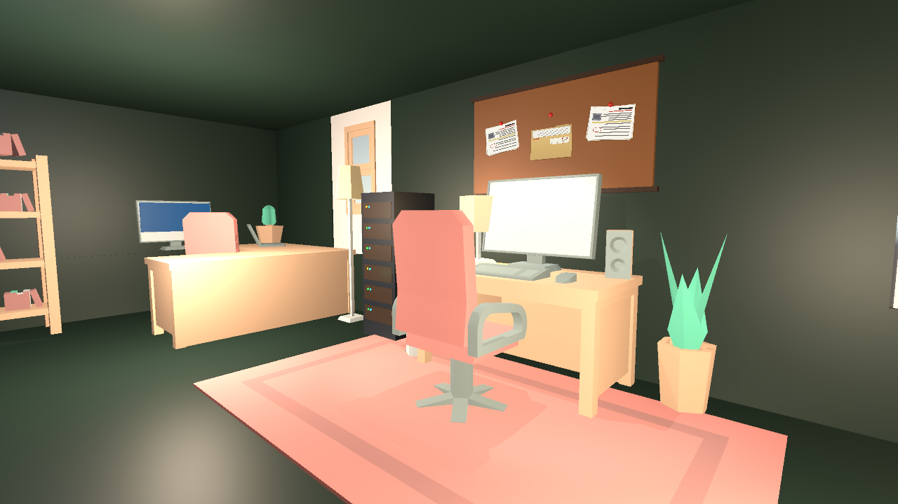
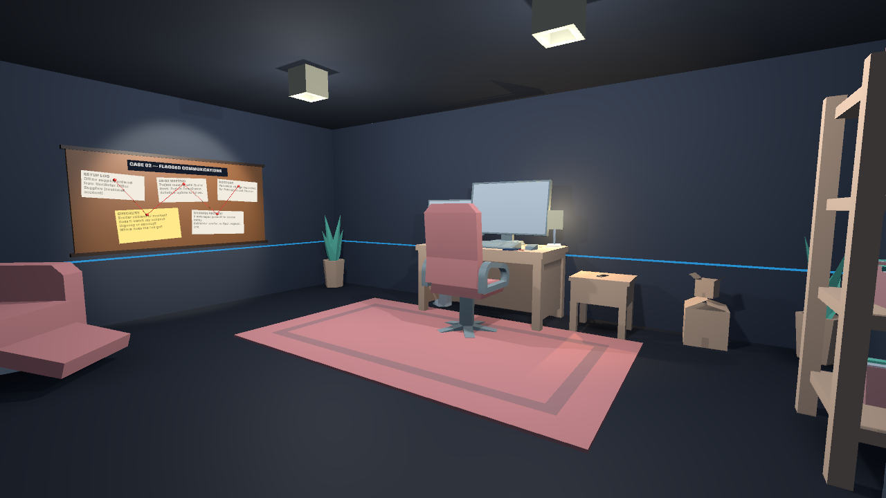
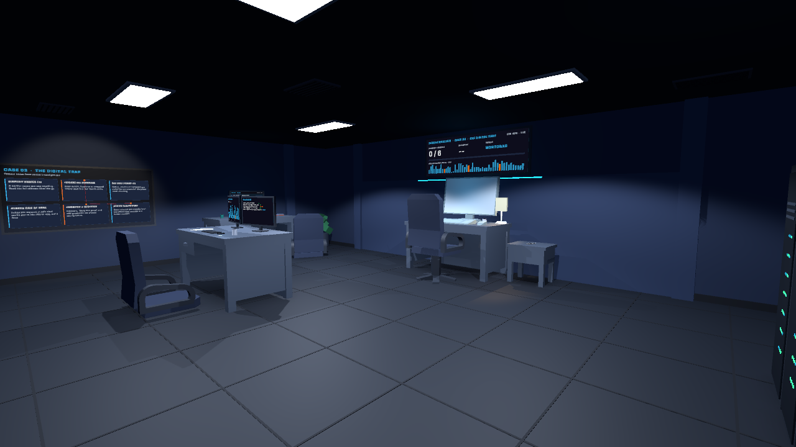
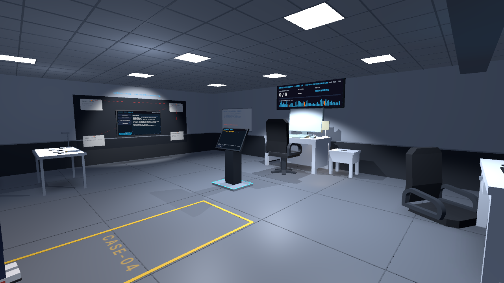
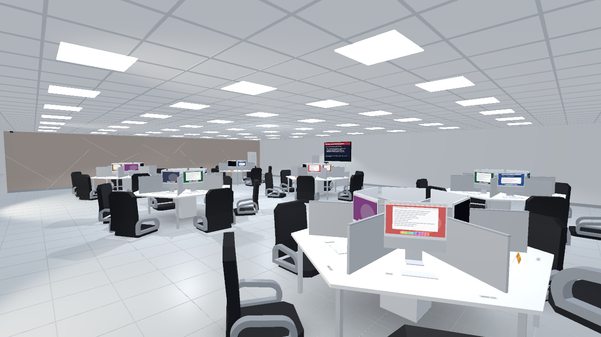

# Scam Sense: Think Before You Click

> A first-person 3D educational game, made in Unity, that teaches players to recognize scam messages before they click. *(BSIT Capstone Project)*




## Table of Contents
1. [About the Project](#about-the-project)
2. [Learning Objectives](#learning-objectives)
3. [Game Overview](#game-overview)
4. [Features](#features)
5. [Screenshots](#screenshots)
6. [Levels](#levels)
7. [Built With](#built-with)
8. [Getting Started](#getting-started)
9. [How to Play](#how-to-play)
10. [Project Structure](#project-structure)
11. [System Architecture](#system-architecture)
12. [Saving and Player Data](#saving-and-player-data)
13. [Development Status and Roadmap](#development-status-and-roadmap)
14. [Known Limitations](#known-limitations)
15. [Testing](#testing)
16. [Troubleshooting](#troubleshooting)
17. [Documentation](#documentation)
18. [Contributing](#contributing)
19. [Team](#team)
20. [License and Credits](#license-and-credits)

---

## About the Project

**Scam Sense** is a capstone project built with **Unity** and **C#**. The player takes the role of an investigator. They receive a case briefing, explore a 3D room, and review incoming text messages, emails, chats and web pages. For each one they decide whether it is a **scam** or **legitimate**.

Online scams are a growing problem, and many people can't tell a phishing message from a real one. The game helps them practise. Every answer is followed by feedback that explains the warning signs (or the reassuring details), so players learn *why* a message is suspicious, not only *that* it is.

**Audience:** students and general users who want to build basic cybersecurity awareness.

## Learning Objectives

After playing, players should be able to:
- **Spot common warning signs** in texts, emails, chats and web pages: unknown or look-alike senders and domains, urgency and threats, requests for passwords, verification codes or payment, and offers that are too good to be true.
- **Recognize legitimate messages** too, such as ones that match something the player actually did, ask for nothing, and point to the official app or site.
- **Check before acting:** inspect the sender, the requested action and where a link would lead, instead of clicking.
- **Learn from mistakes:** every answer explains why the message was a scam or legitimate, and a wrong answer shows what it would have led to.

## Game Overview

| | |
|---|---|
| Genre | Educational / investigation |
| Perspective | First person, 3D |
| Platform | Windows PC (Unity Standalone) |
| Content | All people, messages, links and domains are fictional (`.example` domains); no real links are opened. Level 5 is set in the UPHSL Biñan MacLab, with fictional training messages |

**Core loop**
1. Read the **case briefing**: what happened, case notes and objectives. Then press **BEGIN INVESTIGATION**.
2. Explore the room. A **notification** arrives after a delay or when you move around.
3. Open the message:
   - **texts and chats** on the in-game **phone** (press `E`);
   - **emails and web pages** on a **computer** (look at a monitor and press `E`).
4. Inspect it, then answer **SCAM** or **LEGITIMATE**. Each message gives you time to read it fully; longer messages get more time.
5. Read the **feedback**: whether you were right, the correct answer, and an explanation. A wrong answer also shows what it would have led to and the clue you missed.
6. After the last message, the **results screen** shows your score, case grade, accuracy, stars and career XP, and whether the next room is unlocked.

## Features

### Implemented
- **First-person exploration:** walking, mouse look, jumping, opening doors and sitting on chairs.
- **Five playable rooms**, each with its own case, messages and environment (see [Levels](#levels)).
- **In-game phone:** pull the phone out of your pocket to read and answer texts and chats.
- **Working computers:** a desktop-style mail app on the in-game monitors for emails and captured web pages.
- **Message investigation (emails):**
  - Click the highlighted sender, subject, body phrases and links to inspect them. Simulated links are never opened.
  - Each inspected detail shows a **finding card** on screen; key clues turn gold ★.
  - After you answer, the feedback lists the key clues you **found** and the ones you **missed**.
- **Details panel:** sender details, the requested action and a link description for every message.
- **Scoring per level:** each level sets its own points (100 / 150 / 200 / 250 / 300 per correct answer for Levels 1–5), wrong-answer penalty and time rules.
  - Every message gets a **reading allowance** based on its length and details, so careful reading is never punished.
  - Level 1 has no time pressure. Later levels add a small speed bonus and a small, capped overtime deduction.
  - The timer pauses in the pause menu, while the phone comes out, and briefly after each inspected detail.
- **Wrong-answer consequences:** an investigation error card with a simulated security incident (trusted scams) or an accuracy warning (genuine messages reported as scams), the explanation and the overlooked clue.
  - On emails with clues, a **follow-up re-check** lets you inspect the key details again and answer once more for recovery points.
- **Case evaluation:** a HUD case status and a case grade (A–F), accuracy, evidence found, corrected mistakes and hints on the results screen.
- **Stars (1–3)** reward performance.
- **Score-based unlocking:** reach a room's passing score to unlock the next room. Each room asks for a higher share of its maximum.
- **Educational feedback** after every message, plus lessons on the results screen.
- **Case files and evidence stations** (Rooms 3–5), a **final multi-evidence case** (Room 4), and **workstation-specific emails** in the Room 5 MacLab.
- **Readable case objects:** case folders, evidence documents and investigation boards open in a document reader (`E`).
- **Career progression:** XP from completed cases, cybersecurity ranks and achievements, shown on the menu's Career panel. Replays only add XP when they improve your best.
- **Main menu:**
  - Play / Continue and Level Selection with room previews;
  - Settings (audio, display, quality, mouse sensitivity), How to Play and About;
  - **Reset Progress**;
  - an animated 3D backdrop that cycles through the rooms;
  - **Quit** with a confirmation dialog (closes the built game; stops Play Mode in the Editor).
- **Pause menu**, scene loading screen with tips, fade transitions, and screen flicker and glitch effects.
- **Audio:** notification, answer, star, unlock and button sounds, with separate volume controls.
- **Local save:** progress is saved on the PC per player profile and survives restarts.
- **Player accounts (Supabase):** guest, email + password, and offline play, with cloud sync of progress. See [Saving and Player Data](#saving-and-player-data) for its current status.

### In development / planned
- End-to-end testing of Supabase accounts.
- More scam cases and scenarios.
- Voice acting and background music.
- A downloadable Windows build.

## Screenshots

| Room 1 – The First Case | Room 2 – The Investigation |
|---|---|
|  |  |
| **Room 3 – The Digital Trap** | **Room 4 – Digital Forensics Lab** |
|  |  |
| **Room 5 – The Compromised Campus Network (MacLab)** | |
|  | |

> These are the room previews used in the main menu. To add gameplay screenshots or GIFs later, put them in a folder such as `Docs/images/` and link them here with a relative path, e.g. ``.

## Levels

All five rooms are in the build and playable. Room 1 is always open; each later room unlocks when the previous room's passing score is reached.

| # | Room (scene) | Setting | Messages | Points per correct answer | Max / passing score |
|---|---|---|---|---|---|
| 1 | **The First Case** (`Game`) | A home: texts and emails arrive while you explore the house | 5 (2 texts, 3 emails) | 100 | 500 / 325 |
| 2 | **The Investigation** (`Room2_InvestigationOffice`) | Cybersecurity investigation office with an evidence board | 7 (2 texts, 4 emails, 1 work chat) | 150 | 1155 / 715 |
| 3 | **The Digital Trap** (`Room3_DigitalTrap`) | Dark cybersecurity operations room with a case-files computer | 6 (1 text, 5 emails) | 200 | 1320 / 870 |
| 4 | **Digital Forensics Lab** (`Room4_DigitalForensicsLab`) | Bright forensics lab with evidence stations and a final case terminal | 8 (2 texts, 4 emails, 1 web page, 1 final case) | 250 | 2200 / 1500 |
| 5 | **The Compromised Campus Network** (`Room5_MacLab`) | The UPHSL Biñan MacLab: six hexagonal pods of 36 computers; five flagged workstations each hold one email, and the instructor's computer holds the official records | 6 (1 text, 5 emails) | 300 | 1980 / 1380 |

Room 5 is the final case. The maximum includes the small speed bonuses; the passing scores can be reached without them. Level data (messages, explanations, scoring, timing, stars and unlock rules) lives in `Assets/Levels/*.asset`, and the rooms and systems have notes in `Docs/` (for example `Docs/Level5_MacLab.md` and `Docs/Scoring.md`).

## Built With

| Item | Details |
|---|---|
| Engine | Unity **6000.0.38f1** (Unity 6) |
| Language | C# |
| Rendering | Built-in Render Pipeline |
| UI | uGUI + TextMeshPro; most menus are built at runtime by `UI/UIKit.cs` |
| Input | Unity **Input System** 1.14.2 (`Assets/Input/PlayerInput.inputactions`) |
| Other packages | Timeline, Test Framework, Visual Scripting, 2D Animation (see `Packages/manifest.json`) |
| Online accounts | **Supabase** (Auth + Postgres) over its HTTP API using `UnityWebRequest`; no extra package |
| Version control | Git and GitHub |

## Getting Started

### Prerequisites
- [Unity Hub](https://unity.com/download)
- Unity Editor **6000.0.38f1**
- [Git](https://git-scm.com/)

### Installation
1. Clone the repository:
   ```bash
   git clone https://github.com/c23-2310-967-ops/Scam-Sense.git
   ```
2. In **Unity Hub**, click **Add → Add project from disk** and select the cloned `Scam-Sense` folder.
3. Open it with Unity **6000.0.38f1**. The first open takes a few minutes while Unity rebuilds the `Library` folder.
4. Open `Assets/Scenes/Menu.unity` and press **Play**.

### Optional: online accounts (Supabase)
The game runs without this; progress is then saved on the PC only. To enable accounts:
1. Copy `supabase/SupabaseSettings.example.json` to `Assets/Resources/SupabaseSettings.json`.
2. Fill in the project URL and the **publishable (anon)** key from the Supabase dashboard. Never use the secret or service_role key.

The real `SupabaseSettings.json` is git-ignored and must not be committed. The database setup is in `supabase/migrations/`, and the full guide is in [`Docs/SupabaseAccounts.md`](Docs/SupabaseAccounts.md).

## How to Play

| Action | Key |
|---|---|
| Move | `W` `A` `S` `D` |
| Look around | Mouse |
| Jump | `Space` |
| Interact: phone, computer, doors, chairs | `E` |
| Stand up from a chair | `Space` or `E` |
| Choose answers and buttons | Mouse click |
| Show / hide objectives | `Tab` |
| Start the level from the briefing | `Enter` or **BEGIN INVESTIGATION** |
| Pause menu / leave the computer | `Esc` (`P` also pauses) |

**Investigating a message**
- Open **SHOW DETAILS** to see the sender details, what the message asks you to do, and where a link would lead. Links are never opened.
- On emails, click the underlined details to inspect them. A finding card explains each one, and key clues turn gold ★. Inspecting a new detail pauses the timer for a few seconds of reading time.
- The timer shows the **reading time left** for the message. In Level 1 there is no time pressure.
- After a wrong answer on an email, choose **REVIEW EVIDENCE** to re-check the key details and answer again for recovery points.
- In Room 5, the notification names the workstation (for example `MAC-31`) where the email is flagged.
- Answer **SCAM** or **LEGITIMATE**, then read the feedback and press **CONTINUE**.
- Watch for these warning signs: unknown or look-alike senders, urgency and threats, requests for passwords, codes, payment or gift cards, offers that are too good to be true, and links to unfamiliar domains.

## Project Structure

```
Scam-Sense/
├── Assets/
│   ├── Scenes/            # Menu, Game (Room 1), Room2_InvestigationOffice, Room3_DigitalTrap,
│   │                      # Room4_DigitalForensicsLab, Room5_MacLab, MenuBackdrop_Room1
│   ├── Levels/            # LevelDefinition assets (messages, scoring, unlock rules) + LevelCatalog
│   ├── Scripts/
│   │   ├── Data/          # Level and message data, local save (LocalDataManager), career system
│   │   ├── Game/          # Quiz flow, scoring, game manager, computers, phone, investigation
│   │   ├── Online/        # Supabase client, account service, result upload queue
│   │   ├── UI/            # Main menu, accounts, HUD, briefing, message popup, results, UIKit
│   │   └── *.cs           # Player movement, interaction, doors, chairs, pause, settings, scene loading
│   ├── Editor/            # Editor tools (room builders, level content, previews)
│   ├── Resources/         # Runtime-loaded assets (career config, UI sprites, loading background)
│   ├── Art/LevelPreviews/ # Room preview images
│   ├── Input/             # Input System actions
│   ├── Models/            # 3D models by room (see Docs/ASSET_INVENTORY.md)
│   │   ├── Room1/         # Models only Room 1 uses (house furniture, kitchen, bathroom)
│   │   ├── Room2/         # Models only Room 2 uses
│   │   ├── Room5/         # MacLab walls, hexagonal desk pods and computers (OBJ + prefab)
│   │   ├── Shared/        # Models used by two or more rooms (desk, office chair, monitor, phone, hand)
│   │   └── Unused/        # Rest of the Kenney Furniture Kit, not used by any room
│   └── Materials/, Textures/, Fonts/, Prefabs/, ...   # Art and audio
├── Docs/                  # Feature notes and setup guides
├── supabase/              # Database migrations (linked through GitHub) and the settings template
├── Packages/              # Unity package manifest
├── ProjectSettings/       # Unity project settings
└── README.md
```

Key scripts:

| Script | Purpose |
|---|---|
| `PlayerMotor.cs`, `Mouselook.cs`, `InputManager.cs` | First-person movement, look and jump |
| `PlayerInteractor.cs`, `Door.cs`, `Sittablechair.cs` | Doors and chairs |
| `Game/GameManager.cs` | Level lifecycle: briefing → messages → results; stars, unlocking, saving |
| `Game/QuizManager.cs` | Message delivery, response timer, answers and feedback |
| `Game/ScoringSystem.cs` | Level-based points, reading allowance, penalties, recovery, case grade, stars |
| `Game/WrongAnswerConsequences.cs` | Wrong-answer cards, simulated incidents and the follow-up re-check |
| `Game/ComputerTerminal.cs`, `Game/PocketPhone.cs`, `UI/MessagePopupUI.cs` | Reading messages on computers and the phone |
| `Game/MessageInvestigation.cs`, `Game/InvestigationSession.cs` | Clickable details, finding cards, and the found / missed clue summary (emails) |
| `Data/LocalDataManager.cs` | Local progress save and merge rules |
| `Data/CareerSystem.cs` | Career XP, ranks and achievements |
| `Online/CloudAccountService.cs`, `Online/SupabaseClient.cs` | Accounts and cloud sync with Supabase |
| `UI/MainMenuUI.cs`, `UI/AccountUI.cs`, `UI/ResultsUI.cs` | Main menu, account panels and results screen |

## System Architecture

```
Menu scene ── MainMenuUI ── AccountUI ── CloudAccountService ── SupabaseClient ──> Supabase (optional)
     │                                         │
     │ LevelCatalog (unlock state)             └── syncs ──┐
     ▼                                                     │
Room scene ── GameManager ── BriefingUI                    │
                 │  ├── QuizManager ── IMessagePresenter (phone popup / computer / final case terminal)
                 │  │        └── MessageInvestigation (clickable email clues)
                 │  ├── ScoringSystem
                 │  └── ResultsUI
                 └── LocalDataManager (PlayerPrefs JSON) ◄────────────┘
                      CareerSystem (XP, ranks, achievements)
```

- **GameManager** runs one level: briefing, then **QuizManager** delivers the messages, then the results. It works out stars and unlocking from the final score and saves through **LocalDataManager**.
- **QuizManager** opens each message on a presenter (phone popup, computer, or final case terminal) and scores each answer exactly once.
- **LocalDataManager** is the single source of progress. **CloudAccountService** only merges it with the player's cloud copy.

## Saving and Player Data

- **Local save:**
  - progress is stored as JSON in Unity **PlayerPrefs**, one save per player profile: unlocked and completed rooms, best and last scores, stars, career XP and achievements;
  - settings (volume, display, quality, sensitivity) are saved separately;
  - **Reset Progress** in Settings clears only the active profile's progress.
- **Supabase accounts (implemented; end-to-end testing pending):**
  - **Guest** uses Supabase anonymous sign-in (**Allow anonymous sign-ins** is enabled in the dashboard).
  - **Email + password** accounts have a display name.
  - **Play offline** keeps using the local save, and results upload later.
  - Progress, achievements and run history sync to the tables `profiles`, `level_progress`, `achievements` and `game_results`.
  - **Row Level Security** limits every player to their own rows.
  - A guest is a real Supabase user with an authenticated identity, not the public API key. The policies cover guests explicitly; see [Docs/SupabaseAccounts.md](Docs/SupabaseAccounts.md#public-key-vs-guest-anonymous-users).
- **No secrets in the repository.** The client uses only the public (publishable) key, from a git-ignored file. Scores are sent by the game client, so they suit progress tracking, not competitive leaderboards.

## Development Status and Roadmap

**Completed**
- Five playable rooms with progression, level-based scoring, stars and feedback.
- Wrong-answer consequences, follow-up re-checks and the case grade.
- Phone and computer message reading; email investigation with clickable clues and finding cards.
- Career ranks and achievements; full main menu with settings, previews and Reset Progress.
- Local save; Supabase account and cloud-sync code with the database schema applied.
- 3D models organized by room; Room 5's walls, desk pods and computers are reusable model assets.

**In progress**
- Supabase: test guest play, sign-up, sign-in and sync end to end.

**Planned**
- [ ] More scam cases and scenarios
- [x] Scoring and progress system
- [ ] Voice acting and background music
- [ ] Release a downloadable build

## Known Limitations

- **No automated tests yet.** Testing is manual (see [Testing](#testing)).
- **Online accounts** are implemented but not yet tested end to end. Scores are sent by the game client, so they suit progress tracking, not competitive leaderboards.
- **Windows only**, and no downloadable build has been released yet.
- **Some third-party asset sources are unconfirmed:** the phone and ink pen models, two desk images and the menu music. See [Docs/ASSET_INVENTORY.md](Docs/ASSET_INVENTORY.md).

## Testing

There are no automated tests yet. The Unity Test Framework package is installed but no test scripts exist. Manual checklist:

- [ ] `Menu.unity` → **PLAY** starts Room 1 with its briefing.
- [ ] A notification arrives; a text opens on the phone (`E`) and an email opens on a computer.
- [ ] An answer is scored once. The feedback shows the correct answer and explanation, and **CONTINUE** moves on.
- [ ] On an email, clicking a highlighted detail opens its finding card, and the feedback lists the clues found and missed.
- [ ] The results screen shows score, stars and XP. Reaching the passing score unlocks the next room in **Level Selection**.
- [ ] A locked room can be previewed but not played.
- [ ] A wrong answer shows the consequence card; **REVIEW EVIDENCE** re-checks an email once for recovery points.
- [ ] In Room 5, each flagged email opens only at its workstation (`MAC-xx`).
- [ ] **QUIT GAME → YES, QUIT** stops Play Mode in the Editor and closes the built game.
- [ ] Settings are kept after restarting; **Reset Progress** clears progress after confirmation.
- [ ] Pause (`Esc` / `P`), resume, and return to the menu all work.
- [ ] The Unity Console shows no errors.

## Troubleshooting

| Problem | Fix |
|---|---|
| Unity opens in **Safe Mode** | A script has a compile error. Read the Console, fix the script, then click **Exit Safe Mode**. |
| Pressing Play shows an empty or wrong scene | Open `Assets/Scenes/Menu.unity` first. All rooms are listed in **File → Build Profiles**. |
| "Scene … is not in the Build Profile scene list" | Add the scene under **File → Build Profiles → Scene List**. |
| Account buttons say online accounts aren't set up | `Assets/Resources/SupabaseSettings.json` is missing. See [Optional: online accounts](#optional-online-accounts-supabase). |
| PLAY AS GUEST says guest play isn't switched on | Enable **Allow anonymous sign-ins** in Supabase → Authentication → Sign In / Providers. |
| A room shows the wrong messages | Check that the scene's **GameManager → Level** uses the matching `Assets/Levels` asset. |

## Documentation

| Document | Contents |
|---|---|
| [Docs/DEVELOPMENT_SETUP.md](Docs/DEVELOPMENT_SETUP.md) | Opening the project, scenes, Editor tools, Room 5 models, Git workflow |
| [Docs/ASSET_INVENTORY.md](Docs/ASSET_INVENTORY.md) | Models and assets used in each room, their locations and sources |
| [Docs/Scoring.md](Docs/Scoring.md) | Level-based scoring, reading time and penalties |
| [Docs/WrongAnswerConsequences.md](Docs/WrongAnswerConsequences.md) | Wrong-answer cards and the follow-up re-check |
| [Docs/MessageInvestigation.md](Docs/MessageInvestigation.md) | Clickable email clues and finding cards |
| [Docs/SupabaseAccounts.md](Docs/SupabaseAccounts.md) | Setting up online accounts |
| `Docs/Level1_Implementation.md` … `Docs/Level5_MacLab.md` | Notes for each room |

## Contributing
1. Pull the latest `main` before you start (`git pull`).
2. Keep each change focused, and test it in Play Mode with no Console errors.
3. Don't edit the same Unity scene as a teammate at the same time; scene files don't merge well.
4. Never commit `Assets/Resources/SupabaseSettings.json`, keys or passwords.
5. Write clear commit messages that describe the change (e.g. `Add Level 5 messages`), then push or open a pull request.

## Team

| Name | Role |
|------|------|
| Polly Jireh Mane | Project Manger, Game Designer, Game Developer |
| Andrew Tenorio | Documentary, QA Tester | 
| Prince Moses Jimenez | Documentary, Designer |
| Chester Guille Castillo |Documentary, QA Tester |

## License and Credits

This project was created as a capstone for academic purposes. **No license has been specified**; all rights are reserved by the team unless a license is added.

- Built with [Unity](https://unity.com/); see the [Unity Documentation](https://docs.unity3d.com/).
- 3D furniture models: [Kenney Furniture Kit](https://kenney.nl/assets/furniture-kit) by Kenney (CC0).
- Font: [Inter](https://rsms.me/inter/) by Rasmus Andersson (SIL Open Font License; licence in `Assets/Fonts/Inter-LICENSE.txt`). Fallback font: Liberation Sans, included with TextMesh Pro.
- Third-party assets keep their original licenses; this repository doesn't claim ownership of them. Assets whose source is still being confirmed are listed in [Docs/ASSET_INVENTORY.md](Docs/ASSET_INVENTORY.md).
- Thanks to our capstone adviser and instructors.

---

**Project information:** BSIT capstone · Unity 6 (6000.0.38f1) · C# · Windows · in development
